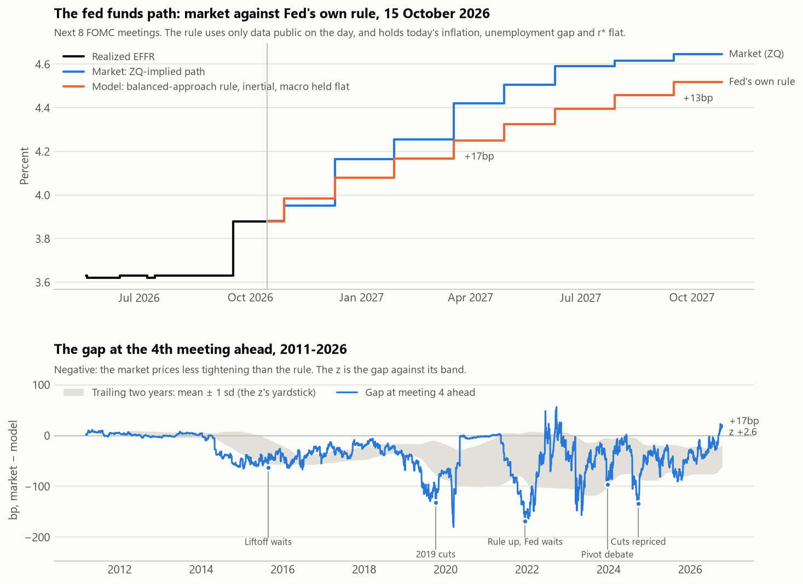

# GlobalPolicyEngine

Does the market price the Fed's own rule? This project measures the policy path the market is pricing against the path a rule the central bank publishes would take, in USD and GBP, and trades the difference. The market path comes from fed funds futures (ZQ) for USD and the Bank of England's fitted OIS curve for GBP. The rule is the balanced-approach rule from the Fed's Monetary Policy Report, fed each day only what had been published by then; for GBP the same rule is applied to UK inputs. A third currency waits on a data purchase; the reasoning is in [notes/DECISIONS.md](notes/DECISIONS.md) (S1).

## The conclusion

The market prices the policy path persistently below the Fed's own rule: in USD, in every year since 2014, at the fourth meeting ahead. When the two disagree, the Fed tends to move toward the market rather than the reverse, so the standardized gap does not forecast the USD rate, and points the wrong way. In GBP it does forecast, but the gain is concentrated in one window (2022-2023) and depends on an r* fixed with hindsight, so it isn't claimed as a tradable signal. The book loses money before costs and after. About half of the cost is rolls and re-strikes the construction forces, and no single choice in the robustness grid turns it positive.

The figures behind each sentence move a little with every build, so this page doesn't restate them. They are in [reports/numbers.md](reports/numbers.md), each linked to the report line that prints it, and the test suite fails while that sheet is behind the reports.

<picture>
  <source media="(prefers-color-scheme: dark)" srcset="reports/figures/model_vs_market_USD_dark.png">
  
</picture>

## Where the results are

| What | Where |
| --- | --- |
| Every number the write-up quotes, each linked to the report line that prints it | [reports/numbers.md](reports/numbers.md) |
| The pipeline, every session, who closes the gap and the decision log, in one page to open in a browser | [reports/explorer.html](reports/explorer.html) |
| The write-up | [Does the market price the Fed's own rule?](Does%20the%20market%20price%20the%20Fed%E2%80%99s%20own%20rule_.pdf) (the .docx beside it) |
| One page, for an email | `reports/tearsheets/tearsheet_<last session>.pdf` |
| The weekly brief | `reports/briefs/`, one a week since September 2011 |
| Every choice, with its date and reason | [notes/DECISIONS.md](notes/DECISIONS.md) |
| The two forward tests, registered before any out-of-sample session is scored | [notes/DECISIONS.md](notes/DECISIONS.md#forward-tests-registered-2026-10-12-before-any-out-of-sample-session-is-scored), H1 and H2 |

Each stage writes its own report to `reports/`, and the numbers behind it as JSON to `reports/results/`, which later stages read instead of re-deriving:

| Report | What it says | Written by |
| --- | --- | --- |
| `coverage_USD.md`, `coverage_GBP.md` | The sessions the market path solved on, and the days missing | `build_panel.py` |
| `sofr_check_USD.md` | The ZQ path against SR1, an independent market | `build_panel.py` |
| `mpr_check_GBP.md` | The GBP path against the Bank of England's MPR conditioning paths | `check_mpr.py` |
| `vintages_USD.md` | What each ALFRED series covers in real time, and where it is thin | `catalogue_vintages.py` |
| `nowcast_USD.md`, `nowcast_GBP.md` | The real-time macro inputs, and the CPI-to-PCE bridge's error | `build_nowcast.py` |
| `model_USD.md`, `model_GBP.md` | The rule's path against the market's, the gap and z, at named moments | `build_model.py` |
| `closure.md` | Who closes the gap: when the market and the rule disagree, which one moves for the same meeting | `build_closure.py` |
| `expression.md` | What each sleeve trades, the checks on its P&L, and what carry and roll cost | `build_expression.py` |
| `credit_USD.md` | The credit bridge: the gap against Baa - Aaa and four other spreads | `build_credit.py` |
| `costs.md` | Costs, turnover and the hysteresis grid, per sleeve | `build_strategy.py` |
| `portfolio.md` | The book, beside its alternative constructions | `build_portfolio.py` |
| `robustness.md` | The book with one choice at a time moved off the chosen specification | `build_robustness.py` |
| `metrics.md` | Attribution, the IC, the level by regime and year, and the tear sheet's numbers | `build_tearsheet.py` |
| `numbers.md` | Every number the write-up quotes | `build_numbers.py` |
| `explorer.html` | The pipeline, a session time machine, who closes the gap and the decision log, in one page | `build_explorer.py` |

## The method in brief

On every session the engine solves the path the market prices over the next eight meetings, and the path the rule gives with that day's inputs held flat. The signal is the gap between them at the fourth meeting ahead, about five months out. Five sleeves trade it in instruments that can be held: the USD and GBP outrights at the fourth meeting, USD and GBP 2s10s on an orthogonalised slope, and the GBP - USD 2y differential. One book sizes them together. The write-up has the construction in full.

The rule, in its inertial form, with the notional rate floored at the lower bound in a named step so the unfloored value stays visible:

R* = r* + π + 0.5(π - 2) + 2(u* - u)

R_k = 0.922 R_(k-1) + 0.078 max(ELB, R*), with R_0 the rate in force

| Term | Definition |
| --- | --- |
| USD inputs | π the 12-month core PCE, bridged from CPI for months PCE hasn't printed yet; u* CBO's estimate as vintaged on the day, from ALFRED |
| GBP inputs | π headline CPI (12-month, the MPC's target); LFS unemployment as first printed; u* a constant 4.5% |
| USD r* | SEP (Summary of Economic Projections) longer-run median; Taylor's 2% before the first SEP (226 sessions) |
| GBP r* | Constant -1.6%, the average real Bank Rate from 2009-2026. A hindsight number. It moves the bp gap and mostly leaves z unchanged, except near the floor |
| z | The gap (market minus rule) at the fourth meeting ahead, standardized against its trailing two-year window after one year of history. z > 0 means the market prices more tightening than the rule, so the sleeve receives |
| IC | Rank correlation of z at a session's close with the change in the rate the sleeve trades over the next h sessions (5, 21, 63), after the one-session execution lag, outside the ELB state. The change is measured as what it earns a unit receive position, carry and roll left out: the fourth meeting's ZQ contract for the USD outright, the OIS forward over that meeting's regime for the GBP outright, and the legs together for the curve and cross sleeves. A positive IC means the side z picks made money on the rate. `backtest/metrics.py` has the definition, and `reports/metrics.md` the IC on total P&L too |
| ELB state | The policy rate on its floor and the rule's notional rate below it. The model has no view there, and the book is flat |
| Hysteresis rule | Enter at \|z\| >= 1, exit at 0; fixed before results |
| Book construction | Inverse-vol weights, shrunk covariance, 5% vol target on the whole book, gross DV01 capped at 0.4% of capital per bp, no drawdown control |
| Sample | The book decides from 250 sessions of history (2012-03-01) and is counted from 2014-01-13, the first session it could hold a position; why that date is [DECISIONS P13](notes/DECISIONS.md#portfolio-2026-09-29). It runs to the last session of the latest build |
| DV01 | Dollar value of a 1 basis point move |
| Sleeve | One traded expression of the signal, e.g. the USD outright |

## Where the code is

The package is `src/policypath/`:

| Path | What |
| --- | --- |
| `sources/` | Every network call, and the cache they write: the Databento archive and API (`archive.py`, `rates.py`), FRED and ALFRED, the New York Fed's HLW r*, the Bank of England, the ONS, and the FOMC and MPC calendars (`pull_fomc.py`, `pull_mpc.py`) |
| `curves/` | The ZQ path solver (`policy_path.py`), the SOFR curve in QuantLib (`build.py`, `helpers.py`), the SR1 basis (`basis.py`), forwards between meetings from the BoE OIS curve (`forward.py`), and the NSS alternative (`nss.py`) |
| `market.py`, `panel.py`, `calendars.py` | One `market.path(date, ccy)` for both currencies, and the path on every session |
| `macro/` | The real-time nowcast: inflation with the CPI-to-PCE bridge, the unemployment gap, activity, and the vintage store |
| `model/` | The rule (`reaction.py`), r* (`rstar.py`), the model path beside the market's (`path.py`), and the estimated-coefficient check (`estimate.py`) |
| `signal/` | The gap and z (`gap.py`), the level, slope and cross-country components, and the cross-country gap |
| `regimes.py` | The ELB state and the policy regime, in real time |
| `strategy/` | Sleeves and their instruments, carry and roll and the checks on them, positions and the hysteresis rule, costs, risk, the book, and the robustness grid |
| `backtest/` | The P&L engine, and `metrics.py`: one definition each of the Sharpe ratio, its SE, the IC and the rest |
| `credit.py` | The credit bridge |
| `closure.py` | Who closes the gap: the market's, the rule's and the policy rate's moves for the traded meeting, against the de-meaned gap |
| `report/` | Every report, figure and brief, the tear sheet, the numbers sheet, and the explorer (`explorer.py` and its page template, `explorer.html`) |
| `config.py` | Reads `config/`: every currency-specific value (`currencies.yml`), the strategy (`strategy.yml`), the brief (`brief.yml`) and the meeting calendars (`meetings/`), validated against a schema when it loads. The explorer's map (`explorer.yml`) is read and checked by `report/explorer.py` |
| `regress.py`, `run_all.py` | The regression harness, and `uv run all` |

Outside the package: `scripts/` holds one entry point per build step (below), `tests/` the suite and its committed fixtures (`tests/data/`), and `notes/` the decisions, the credit section, the config inventory, and the EUR and AUD scoping spikes.

## Install

Python >=3.12 (developed on 3.13; the code uses 3.12 f-string syntax). Dependencies are `pandas`, `pyarrow`, `databento`, `requests`, `pyyaml`, `matplotlib`, `openpyxl` and `QuantLib`, the last pinned to an exact version because its bindings change signatures between releases. `beautifulsoup4` is dev-only, used by the FOMC scraper, which never runs inside the test suite.

```bash
uv sync
```

The package is src-layout (`src/policypath/`) and is installed editable by `uv sync`, so it is imported as `policypath`, never off `sys.path`.

## Reproduce

### The tests

The test suite runs on committed fixtures and needs neither the network nor the Databento archive. It passes on both the Mac and Windows: the committed fixture reference, frozen on the Mac, is checked to `regress.PLATFORM_ULPS` rather than bit for bit, so last-bit floating-point differences between machines pass (notes/DECISIONS.md, A18).

```bash
uv run pytest -q
```

### Everything, in one command

Every report is one command. It first brings the cache up to date for every enabled currency, then stops unless each currency's market data was pulled the same day, so no report is cut at an older date for one currency than another. Then it builds in the order listed below. `--cache-only` builds from the cache as it is (the check still runs), and `--from <script>` resumes at a step:

```bash
uv run all
```

### Step by step

Rebuilding the market path takes two commands. The first updates every enabled currency (`--ccy` names fewer) and needs the archive (paid, gitignored -- see [Data](#data)) and a free FRED key in `.env`. A first build takes about thirteen minutes; after that it is incremental, and a second run adds nothing:

```bash
uv run --env-file .env python scripts/update_data.py
```

The second reads only the cache. It writes the path panel to `data/panel/`, and the coverage report, the SR1 cross-check and the figures to `reports/`:

```bash
uv run python scripts/build_panel.py
```

One session, solved exactly as the panel solves it:

```bash
uv run python scripts/run_implied_path.py 2024-09-17
```

The macro side needs only the FRED key, not the archive. Pull every ALFRED vintage, then catalogue what each series covers and build the real-time nowcast from the cache (`reports/vintages_USD.md`, `reports/nowcast_USD.md` and its figures):

```bash
uv run --env-file .env python scripts/update_data.py --macro-only
uv run python scripts/catalogue_vintages.py
uv run python scripts/build_nowcast.py
```

One date's nowcast, as it could have been read that evening:

```bash
uv run python scripts/run_nowcast.py 2024-01-20
```

With the panel and the nowcast built, one more command writes the model path, the gap signal, the backtest, `reports/model_USD.md`, its figures and the dated one-page note `reports/onepager_USD_<session>.pdf`. Another prints one session's market and model paths side by side:

```bash
uv run python scripts/build_model.py
uv run python scripts/run_model_path.py 2021-11-01
```

GBP needs no archive, but its update needs the FRED key too, for the dollar-sterling rate (DEXUSUK). Pull the Bank of England's curves, SONIA and Bank Rate and the ONS vintages, then build the panel, the nowcast and the model, and check the path against the Bank's MPR conditioning paths:

```bash
uv run --env-file .env python scripts/update_data.py --ccy GBP
uv run python scripts/build_panel.py --ccy GBP
uv run python scripts/build_nowcast.py --ccy GBP
uv run python scripts/build_model.py --ccy GBP
uv run python scripts/check_mpr.py
```

With both currencies' models built, who closes the gap: when the market and the rule disagree at the traded meeting, how far each moves for that meeting over the next 5, 21 and 63 sessions, and the policy rate with them (`reports/closure.md`):

```bash
uv run python scripts/build_closure.py
```

With both currencies' panels, nowcasts and models built, the strategy layer reads only `data/panel/` and the cache. The expression and carry come first, since the brief's trades table reads them. Then the credit bridge:

```bash
uv run python scripts/build_expression.py
uv run python scripts/build_credit.py
```

The weekly brief, for every currency in `config/brief.yml`, one page to `reports/briefs/brief_<date>.pdf`. `--date` gives the brief that could have been sent on a past day:

```bash
uv run python scripts/build_brief.py
```

Costs and the hysteresis grid, per sleeve (`reports/costs.md`):

```bash
uv run python scripts/build_strategy.py
```

The book, then the robustness grid. The grid stops unless its baseline equals the book's headline in `reports/results/portfolio.json`, so the book goes first. A first grid build rebuilds every row's signal (about 100s); after that it reuses the ones whose inputs have not changed, and `--rows` rebuilds only the rows it names:

```bash
uv run python scripts/build_portfolio.py
uv run python scripts/build_robustness.py
```

The tear sheet, one page to `reports/tearsheets/tearsheet_<last session>.pdf`, with the attribution behind it in `reports/metrics.md` and `reports/results/metrics.json`. It runs the book in memory from the panels and the cache (about 10s), so it needs none of the reports above:

```bash
uv run python scripts/build_tearsheet.py
```

The numbers sheet: every number the write-up quotes, read from the reports above and their JSON, each linked to the report line that prints it, in `reports/numbers.md`. It needs no data and stops if a report no longer prints a number its JSON holds. The test suite fails while the committed sheet is behind the reports, so rerun it after any build above:

```bash
uv run python scripts/build_numbers.py
```

The explorer, last: one page, `reports/explorer.html`, that opens from disk in any browser with nothing loaded from the network. It holds the pipeline (each stage's code, reports, numbers, decisions and tests, from `config/explorer.yml`), a time machine over every session of each currency, who closes the gap, and the decision log. It reads the numbers sheet, `closure.json` and the panels, and runs the book's setup in memory for each sleeve's side (a few seconds). It stops if the map names a path, a numbers-sheet item or a DECISIONS section that does not exist, or if a DECISIONS section is on no stage:

```bash
uv run python scripts/build_explorer.py
```

Before changing anything that computes, freeze every stage's output over the full sample, then check after each change. A check stops at the last session the freeze covered, so an updated cache compares like for like. It exits non-zero on any difference, however small. The committed fixtures have their own reference, which the test suite checks:

```bash
uv run python scripts/regress.py freeze
```

```bash
uv run python scripts/regress.py check
```

## Checks

What guards the numbers, and where each check's result is:

- **The ZQ path against SR1.** An independent market on a different overnight rate, settling on SOFR as ZQ settles on EFFR. The basis the two imply together is compared with the basis later realized (`reports/sofr_check_USD.md`).
- **The GBP path against the Bank's own MPR conditioning paths** (`reports/mpr_check_GBP.md`). The Bank averages a smooth forward curve and the path here is a step, so the differences have a known sign.
- **No look-ahead.** `tests/test_no_lookahead.py` reruns the whole chain cut off on day D, then appends deliberately corrupted data after D and checks that nothing on or before D moves. It runs per currency.
- **The P&L split.** Carry, roll and the rate's move must add up on every session; an independent full revaluation from each instrument's own price must land inside a bound set by convexity; and synthetic convergence tests pin the direction. The build refuses to write the report if any of the three fails (`strategy/carry.py`).
- **No currency in shared code.** `tests/test_no_currency_branches.py` fails if a shared module names a currency.
- **The regression harness.** `scripts/regress.py` freezes every stage's output and checks it bit for bit (above).
- **The numbers sheet.** `scripts/build_numbers.py` stops if a report no longer prints a number its JSON holds, and the suite fails while the sheet is stale.
- **The explorer's map.** `scripts/build_explorer.py` stops if `config/explorer.yml` names a path, a numbers-sheet item or a DECISIONS section that does not exist, or if a DECISIONS section is on no stage; `tests/test_explorer.py` checks the same against the committed files.
- **One-off studies** that no build recomputes, such as pinning a short first regime to the last fixing, are recorded with their results in [notes/DECISIONS.md](notes/DECISIONS.md) (M3).

## Data

- **`databento/`** is gitignored and not distributed: it is a paid batch archive, ~1.2 GB, one definition and one statistics file per day per Databento batch job. Six jobs cover ZQ from 2010-06-06 to 2026-09-21, SR3 from 2020-12-31 to 2026-09-21, and SR1 from 2010-06-06 to 2026-09-24 (it first listed in 2018). Every job names its daily files the same way, so each is kept in its own folder, `databento/<definitions|statistics>/<job_id>/`, with its manifest, metadata and condition files. Download a new job straight into `databento/definitions/` or `databento/statistics/`, then run `uv run python scripts/file_databento.py`. It files every file under its job by the sha256 in the job's manifest, so the ` (2)` copies a browser makes of colliding names do not matter, and it checks every job is complete. `sources/archive.py` knows which job holds which root, and only `sources/` reads the archive. The days after the last job come from Databento's historical API when `DATABENTO_API_KEY` is set (`--archive-only` skips it). It asks for the same dataset, schema and parent symbols, so the records are the batch job's, with the same receive times. Each request is priced first and the update is capped at `rates.LIVE_BUDGET_USD`; a day of all three roots is about a cent (notes/DECISIONS.md, E14-E15). The archive holds settles, not quotes, so there is no bid-offer data: ZQ's cost is its tick, and every other leg's is assumed.
- **`data/`** is gitignored and entirely derived. `data/cache/` holds one parquet vintage log per `(source, currency, series)` plus `manifest.json`, which records the ranges already covered and is what makes `update_data.py` incremental. Every observation carries a reference date and a publication date, and a revised value is a new vintage, not an overwrite. A revision the source can't date, and no longer serves once replaced, exists only in this cache, so `scripts/backup_cache.py` snapshots it after each update. CME sends a preliminary settle around 16:00 ET and the final that evening, or on the Sunday for a Friday session. Both are kept, so a read at the close sees the preliminary. The panel uses each session's settles as they stood by the end of the next business day, and records when the last one arrived.
- **FRED** (free key) supplies the rest of the USD side: EFFR, SOFR and the target range, ALFRED vintages for the macro inputs, H.15 Treasury par yields for the Treasury legs, Moody's Baa and Aaa for credit, and DEXUSUK for sterling. ICE BofA's OAS series are on FRED only for the last three years (from 2023-09-29 as the cache stands), so they are a short cross-check, never the headline.
- **Bank of England and ONS** data need no key: `sources/boe.py` (IADB series, the OIS curve archive, the nominal gilt curve for the gilt legs) and `sources/ons.py` (revisions triangles, the release calendar). The MPC calendar is scraped by `sources/pull_mpc.py` into the committed `config/meetings/mpc.csv`, and the FOMC calendar by `sources/pull_fomc.py` into `config/meetings/fomc.csv`; each session sees the calendar as it stood that day. `tests/data/boe/conditioning_paths.csv` is ground truth taken once from the Bank's Projections Databank.
- **`data/reference/`** is gitignored too: the full-sample outputs `scripts/regress.py freeze` wrote, one folder per currency, with a `meta.json` saying what code and which sessions they cover.
- **`reports/`** is generated (the table above says which script writes what). Reports are never edited by hand.
- **`tests/data/`** is committed precisely so the suite runs for anyone who clones the repo without that archive. Everything in it is small enough to read in a diff. That includes a handful of single-day ZQ, SR1 and SR3 settlement strips from CME, taken from the licensed archive; everything added for the strategy layer (expression, carry, costs, the book, credit) is synthetic. Rebuilding the full sample needs a Databento licence for GLBX.MDP3. Regenerate with `uv run --env-file .env python tests/data/build_fixtures.py` (needs the archive and the network; `--market-only` leaves the ALFRED fixtures as they are).
- **`tests/data/fedwatch/`** holds hand-typed captures of the CME FedWatch tool. FedWatch keeps a year of probability history per meeting, downloadable from the tool, and CME's paid FedWatch API serves history from 2015, so a historical comparison with the ZQ path is possible; it isn't built. FedWatch prices off the same fed funds futures, so that comparison would check this repo's solver against CME's method, not the market data; the SR1 check is the independent one. Each capture stores the futures strip *and* the probabilities from the same screen, so comparing them isolates bootstrap-vs-bootstrap difference from data timing. Rows are laid out exactly as the tool displays them so a capture can be checked against the screenshot cell by cell, and every file opens with a one-line provenance note on line 1 (the readers skip it by position).

## Conventions

Five rules the code is written to and should keep being written to:

1. Every function that touches macro data takes an `as_of`. No "latest values" convenience overloads, no full-sample fits.
2. Network calls live only in `sources/`. Everything else reads from cache or committed fixtures. Observations carry both a reference date and a publication date.
3. Currency-specific behaviour lives in config, not in branches. Branching on the currency inside a module is a bug, and `tests/test_no_currency_branches.py` fails on one. Adding a currency should need only a config block (the schema in `config.py` says what is missing), a meetings file, and a source module if its data comes from a new provider.
4. The test suite passes on every commit, and `scripts/regress.py check` is identical after every refactor. A change that moves a number is a decision: it gets a row in `notes/DECISIONS.md` before the reference is refrozen.
5. Reports are generated, never hand-edited.
